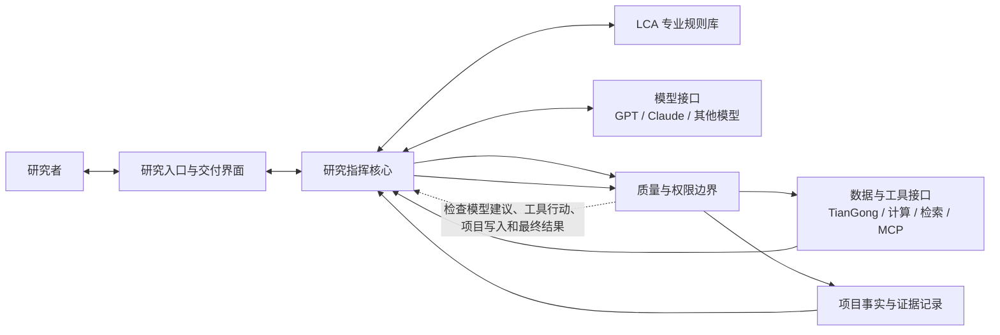

# LCA 科研 Agent 顶层架构基线（人看版）

status: approved_top_level_architecture  
updated_at: 2026-07-23 Asia/Shanghai

## 先说结论

上一个“Agent—Skill—外部工具”的三层说法不够好。它把三种不同性质的东西放在了同一层级：Agent 是控制者，Skill 是工作方法，TianGong 和 MCP 是外部能力。它们并不是能够平行分工的三个部门，所以边界越讲越模糊。

外部成熟方案虽然名字不同，但共同点很稳定：

- 模型不等于 Agent。模型负责理解、判断和提出行动；运行系统负责推进、暂停、恢复、权限和记录。
- 工具不等于 Agent。工具执行明确操作并返回结果，不能自己决定研究目标，也不能把返回内容直接升级成结论。
- 会话不等于项目事实。对话可以压缩、丢弃或换模型；正式数据、证据、决定和工件必须另存。
- 多 Agent 不是成熟度标志。Council、manager、handoff 都只是遇到真实分歧时可选的执行方式。
- MCP 是连接协议，不是产品中心；接得上一个服务器，也不代表服务器里的数据自动可信。
- Agent 不能只验最后一句答案，还要验它走过的路径、使用的工具和是否越权。

因此，正式采用的不是“更多层”，而是：**一条控制主线，连接四类彼此独立的能力，再由一条质量与权限边界守住所有执行和正式写入。**

## 产品仍然是什么

它是一个自主推进 LCA 科研工作的 Agent。

用户提供研究目标、静态材料和约束。Agent 可以使用 GPT、Claude 或后续模型处理复杂理解与判断，优先使用 TianGong 的规范、数据和原生工具，并在需要时调用检索、代码、计算和其他 LCA 工具。它的责任不是“说一段像答案的话”，而是持续推进到：

1. 一个来源、计算和限制都能检查的 LCA 研究结果；或
2. 一个边界清楚、能说明为什么目前不能再下结论的受限结果。

它不是通用科研助手，不替代 TianGong，也不把某个新能源汽车案例固化成产品本身。

## 正式目标结构

这里没有把 Council 画成一层，也没有把 MCP 画成一层。它们分别是指挥核心的一种可选工作方式，以及数据与工具接口中的一种连接方式。

## 七个部分各自负责什么

| 部分 | 真正负责 | 输入与输出 | 明确不能做 |
| --- | --- | --- | --- |
| 研究入口与交付界面 | 接收研究委托、固定材料版本、提出必要问题、交付结果 | 输入是目标、材料、约束；输出是版本化委托和人能审核的结果 | 不自行做科学判断，不把聊天文字直接当正式事实 |
| 研究指挥核心 | 决定当前最值得做什么，选择模型和工具，推进、重试、降级、暂停和恢复 | 读取项目事实，发出模型或工具请求，形成候选变更和唯一下一路线 | 不制造证据，不绕过检查写入正式状态，不因有 Council 就默认拆任务 |
| LCA 专业规则库 | 保存稳定的 LCA 方法、数据分类、证据适用性和论断规则 | 接收标准、TianGong 规范和项目方法版本；返回当前需要的专业规则 | 不保存动态项目事实，不执行整个案例，不替模型开放推理 |
| 模型接口 | 把 GPT、Claude 等模型接到统一合同上，让模型提出分析、解释和工具请求 | 接收当前问题、最小上下文和输出格式；返回结构化候选 | 不直接执行外部操作，不改正式数据，不把模型记忆当权威 |
| 数据与工具接口 | 接 TianGong、检索、代码、LCA 计算工具和 MCP，并保存真实运行证据 | 接收通过权限检查的请求；返回带来源、版本、运行记录的结果或失败 | 不决定研究方向，不把 MCP 等同于权威，不把脚本或设计稿冒充计算结果 |
| 项目事实与证据记录 | 保存这项研究已经接受的事实、候选、假设、缺失、工件、决定、风险和恢复位置 | 接收通过检查的变更；输出当前项目真相和最小上下文 | 不自动接纳模型文本，不把对话当状态，不丢失原值、单位、来源和转换链 |
| 质量与权限边界 | 在行动前检查权限，在接纳前检查科学与工程质量，同时评价过程和结果 | 接收工具请求、候选变更和交付候选；输出允许、修订、降级或少数人工事项 | 不成为第二个指挥者，不用“格式正确”冒充“科学正确”，不为低风险内部工作反复索权 |

## 它们怎样合作

一次完整推进不是“模型自由发挥”，而是下面这条闭环：

1. 用户材料先被固定成一个版本，正式材料和聊天补充分开。
2. 指挥核心从项目记录里只取当前问题需要的事实，再从 LCA 规则库取当前需要的专业规则。
3. 模型收到一个有限、结构化的问题。它可以判断、解释或建议调用工具，但它的任何输出都只是候选。
4. 指挥核心准备工具请求；质量与权限边界先判断能不能自动执行。
5. TianGong 或其他工具真正执行，返回的数据必须带来源、版本和运行状态。
6. 指挥核心结合工具结果继续推理，形成候选事实、模型、计算或结论。
7. 质量与权限边界同时检查“怎么做的”和“做出了什么”。只有通过的内容才进入项目记录。
8. 如果还存在可自主推进的下一步，Agent 继续；只有答案确实在用户手里、用户必须承担责任或主目标会改变时，才暂停询问。

这条连接规则解决了此前几个反复出现的问题：模型不会自行改 TianGong，工具返回不会自动成为结论，对话压缩不会改变项目事实，Council 讨论也不会产生第二份状态。

## 正式数据、候选数据和 TianGong

本项目继续把 TianGong 作为第一权威，但“第一权威”必须落实为可执行规则：

- 已选定版本的 TianGong 规范、数据和原生工具输出，在其声明覆盖范围内优先。
- Agent 跟随采用的 TianGong 版本变化，不自行“修正”TianGong 正式数据。
- TianGong 没覆盖的部分，Agent 可以向用户询问、检索其他一手来源、运行计算或提出假设，但这些内容只能先进入候选、计算、假设或缺失类别。
- 来源是否权威、是否适用于当前项目、计算是否可复现，是三个不同问题。接入 MCP 或调用某个数据库并不能跳过这三项判断。

输入也按你此前确认的方式处理：一次研究以静态、可版本化的材料包开始。Agent 发现关键缺失时先问用户有没有；用户没有时再自行处理。动态检索到的新内容是追加的候选证据，不会悄悄改写原材料。

## Council、Skill、MCP 和案例放在哪里

- **Council**：只在存在真实的多方案争议、需要独立反驳或盲审时开启。它位于研究指挥核心内部，不拥有另一份项目状态，也不拥有更大的权限。
- **Skill**：保存一套可复用的专业做法，属于 LCA 规则或工具适配的一部分。Skill 不应承担项目数据库、长程恢复和正式状态管理。
- **MCP**：属于数据与工具接口。它解决“怎样接进来”，不解决“是不是权威”“该不该使用”“结果能不能进入结论”。
- **案例**：LiFePO4、Freshwater、NEV、USLCI 等只能作为测试材料或回归夹具。它们不能反过来规定产品的核心模块。

## 怎样检验这个 Agent，而不是只检验模型

成熟 Agent 要同时检查两件事：

### 过程是否正确

- 是否先明确研究问题、功能单位和范围；
- 是否区分正式、候选、假设、计算和缺失；
- 是否优先使用正确版本的 TianGong；
- 是否选择了合适的模型与工具；
- 是否发生越权、重复循环、无效等待或过度向用户索权；
- 工具失败或数据缺失时，是否找到合理的降级路线。

### 结果是否可信

- LCA 方法是否成立；
- 数值、单位、边界、过程关系和来源是否能追溯；
- 是否真的运行了计算，而不是只生成脚本或设计稿；
- 结论强度是否超过证据；
- 第三方能否复现；
- 结果是否真的帮助研究者继续工作。

因此，比较 GPT 和 Claude 时，应固定同一份研究委托、工具权限、TianGong 版本和评价标准，既看答案，也看过程。一次回答更漂亮，不能证明整体 Agent 架构更好。

## 外部案例给出的具体启发

| 参考 | 借鉴什么 | 不照搬什么 |
| --- | --- | --- |
| [OpenAI Agents SDK](https://openai.github.io/openai-agents-python/agents/) | 把 Agent 定义和 Runner 执行循环分开；模型、工具、会话、护栏和追踪各自有接口；多 Agent 只是可选编排 | 不把 manager 或 handoff 当默认架构，不让供应商 SDK 决定 LCA 产品边界 |
| [Claude Managed Agents](https://platform.claude.com/docs/en/managed-agents/overview)、[工具合同](https://platform.claude.com/docs/en/managed-agents/tools)、[权限策略](https://platform.claude.com/docs/en/managed-agents/permission-policies) | 模型只发结构化工具请求，应用负责执行；Agent、环境、会话、事件分开；权限按工具能力预先定义 | 不绑定托管平台的 beta 形态，不把编码沙箱直接当 LCA 环境 |
| [Google ADK Runtime](https://adk.dev/runtime/)、[Session/State/Memory](https://adk.dev/sessions/)、[Agent Evaluation](https://adk.dev/evaluate/) | 暂停恢复属于运行时；会话、临时状态和跨会话记忆分开；同时评价行动路径和最终结果 | 不为了“全功能”再引入一整套平台，不把 Memory 当项目事实 |
| [LangGraph](https://docs.langchain.com/oss/python/langgraph/overview) | 把耐久执行、持久化和人工介入放在低层运行时；允许确定性步骤与模型判断混合 | 不先画完整流程图再找用户问题，不把开放科研判断全部写成固定节点 |
| [Pydantic AI](https://pydantic.dev/docs/ai/core-concepts/agent/) | 模型、工具参数、依赖和最终结果之间使用机器可检查的合同；校验失败可进入修订 | 不让 Python 类型或某个库反过来决定产品结构 |
| [OpenHands SDK](https://docs.openhands.dev/sdk/arch/overview) | 把推理循环、Conversation、Workspace、Tools、Events 和 Security 分开；执行环境单独受控 | 不照搬编码 Agent 的终端和文件假设 |
| [MCP 官方架构](https://modelcontextprotocol.io/docs/learn/architecture) | Host 保留模型集成、授权和安全；服务器只提供工具、资源和提示；能力可组合 | 不把 MCP 当 Agent 本体，不把“可连接”当“可信” |

这些来源目前只支持架构模式判断，尚未在本项目内逐个复现实验，所以机器版把它们标为 `official_documentation_inspected_not_locally_reproduced`，没有声称已经验证迁移成功。外部模式支持设计选择，但不替代后续本地实现验收。

## 三条路线比较

### 路线 A：模型中心的薄 Agent

主要靠提示词、Skills 和模型自己调用工具。它最快，但项目事实容易混进对话，模型一换行为就漂移，长任务恢复与权限也不稳定。不建议作为产品核心。

### 路线 B：单一控制主线 + 可替换接口 + 独立项目记录（已批准）

模型负责判断，工具负责执行，LCA 规则负责专业约束，项目记录保存正式事实，指挥核心负责连续推进，质量与权限边界守住所有行动和写入。它既不会把模型能力重新实现一遍，也不会把产品缩成提示词包装。

### 路线 C：完整工作流图或多 Agent 平台优先

它适合已经稳定、可判定的流程，但我们现在仍有开放的科研判断。如果过早采用，会把案例细节写进核心，并重复过去“大量控制结构先于真实产品合同”的问题。只有后续证据表明路线 B 的运行时不够，才应升级。

## 旧资产怎样处理

新架构不会为了利用旧代码而扭曲自己：

- Research Kernel 中能支撑项目记录、溯源、恢复和质量检查的部分，逐项验证后复用；
- Director 或 Controller 只有符合新的指挥合同，才成为研究指挥核心的实现；
- Council 降为可选策略；
- Skills 降为专业方法或薄适配；
- TianGong 接入、版本和溯源能力优先保留；
- 具体案例代码只作为评测夹具，不能证明价值时继续冻结；
- Goal 同步、CONTEXT 投影和版本管理属于运行支撑，不再冒充产品本身。

本基线正式确定目标架构，但不声称现有实现已经迁移完成。`CONTEXT.md` 仍是上一个已完成执行 Goal 的事件投影，不能手工改写；暂停中的案例执行和实现文件保持不动，直到新的迁移 Goal 真实激活。

## 已确认的根边界

已经确认：**“项目事实与证据记录”是唯一被接纳的项目事实来源。模型对话、Council 讨论、工具原始返回和临时记忆都只能提供候选或证据输入，不能直接成为正式事实。**

完整顶层结构也已批准。下一步是对现有系统做模块映射，决定哪些保留、降级、冻结或删除，并明确真正缺少的能力；仍然不需要先跑一个新的具体案例。
